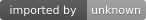

# assctl

[](https://pkg.go.dev/github.com/psyb0t/assctl/pkg/ass)
[](https://github.com/psyb0t/assctl/actions/workflows/pipeline.yml)
[](https://github.com/psyb0t/assctl/actions/workflows/pipeline.yml)
[](https://github.com/psyb0t/assctl/releases)
[](LICENSE)
[](https://github.com/psyb0t/assctl/blob/badges/importers.md)

Your subtitles already have timing. Now make the damn things look good. assctl creates, inspects, edits, validates, and themes Advanced SubStation Alpha (ASS) files, from a terminal or your own Go code.

## Contents

- [Install](#install)
- [Quick start](#quick-start)
- [Presets](#presets)
- [Go package](#go-package)
- [Agent integrations](#agent-integrations)
- [Development](#development)
- [Sponsor](#sponsor)
- [License](#license)

## Install

Go 1.26 or newer.

```bash
go install github.com/psyb0t/assctl/cmd/assctl@latest
```

## Quick start

```bash
assctl inspect captions.ass
assctl theme --preset ivory-navy --output styled.ass captions.ass
assctl validate styled.ass
```

`theme` updates the style definitions and preserves the original dialogue, event timing, inline tags, and unrelated sections. Use `--style NAME` to theme just one style. Use `-` to read or write through a pipe.

`create` builds a script from typed JSON. `captions` turns already timed text into styled captions. `edit` changes selected script settings, style columns, and individual events. See the [CLI guide](docs/cli.md) for examples and the JSON shape.

## Presets

Pick a whole look, including the font, colors, background, outline, shadow, and placement. Tweak any of it when the defaults aren't your thing.

| Preset | Text and background | Secondary karaoke color |
| --- | --- | --- |
| `black-gold` | Bold white text, opaque black box | Gold |
| `ivory-navy` | Ivory serif text, navy box | Sky blue |
| `mint-plum` | Bold mint text, plum box | Peach |
| `clean` | White text, black outline, clear background | Sky blue |

Run `assctl presets --json` to see the full values. Use one of those objects as a starting point for `--theme-file` with `captions` or `theme`. Inline overrides in an existing subtitle still take effect.

## Go package

```bash
go get github.com/psyb0t/assctl/pkg/ass
```

Use `ass.Parse` and `Document.Apply` for edits, or `ass.NewScript` and `Script.Encode` to create a script. See the [Go guide](docs/go.md).

## Agent integrations

The skill documents how to use the installed command on local subtitle files.

```bash
claude plugin marketplace add psyb0t/agents
claude plugin install assctl@psyb0t

codex plugin marketplace add psyb0t/agents
codex plugin add assctl@psyb0t

openclaw skills install @psyb0t/assctl
```

## Development

```bash
make check
make test-coverage
make sec
```

The Makefile runs Go checks in the same development image locally and in CI. Branch pushes check the source. Version tags wait for that commit's default-branch checks before the release and ClawHub publish. See [releases](docs/development.md).

## Sponsor

<a href="https://www.buymeacoffee.com/psyb0t"></a>

## License

[MIT](LICENSE).
